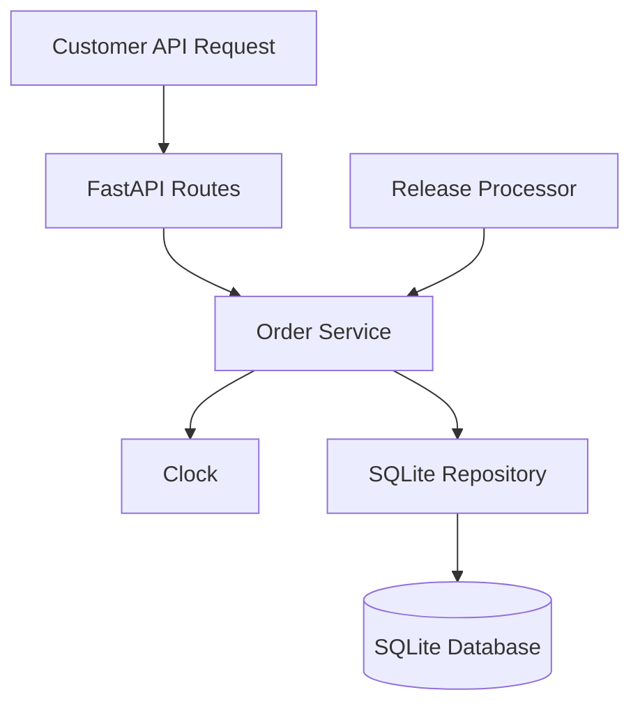

# MiniDash — Track A: Scheduled Orders

## 1. System Overview

MiniDash is a food delivery REST API built using Python, FastAPI, and SQLite.

The Scheduled Orders feature allows customers to choose a future delivery time. The system validates the requested time, checks restaurant operating hours, and stores the order with a SCHEDULED status.

Thirty minutes before the requested delivery time, the system releases the order by changing its status to PLACED.

## 2. System Components

### API Routes
The API receives customer requests to create, view, update, and cancel orders.

### Order Service
The service handles business rules, including scheduling limits, restaurant availability, order cancellation, and automatic release.

### Database Repository
The repository reads and writes restaurant and order information in SQLite.

### Release Processor
A release processor checks scheduled orders and changes eligible orders from SCHEDULED to PLACED.

### Clock
An injectable clock provides the current time. This allows automated tests to simulate different times without waiting.

## 3. Database Changes

The existing orders table will gain one optional column:

- scheduled_for: The requested delivery date and time, stored in UTC.

Existing orders without a scheduled delivery time will continue to work normally.

Scheduled orders will use the SCHEDULED status until they are released.

## 4. API Changes

### POST /orders

The request body will support an optional scheduled_for field.

If scheduled_for is missing, the order will be placed immediately.

If scheduled_for is provided, the system will:

1. Verify that the delivery time is between 45 minutes and 7 days from now, inclusive.
2. Verify that the restaurant is open at the requested delivery time.
3. Create the order with status SCHEDULED.

Invalid requests will return an appropriate HTTP error.

### GET /orders/{order_id}

The response will include scheduled_for when the order has a scheduled delivery time.

### PATCH /orders/{order_id}/status

The existing endpoint will continue to support normal order status updates. Cancellation of scheduled orders will be allowed only before release.

## 5. Automatic Release Logic

The release processor will find orders where:

- status is SCHEDULED
- scheduled_for is at or before 30 minutes from the current time

Each eligible order will be updated from SCHEDULED to PLACED.

The database update will check that the status is still SCHEDULED, preventing repeated releases if the processor runs more than once.

For this project, the processor will run periodically while the application is running. It will also check overdue scheduled orders when the application starts.

## 6. Architecture Diagram



## 7. Architecture Decision Record (ADR)

### Decision: Use a Database-Backed Release Processor

**Context:**
Scheduled orders must be released 30 minutes before delivery. The system must avoid releasing the same order more than once.

**Options Considered:**

1. In-memory timers: Simple, but scheduled timers can be lost when the server restarts.
2. External task queue: More scalable, but adds unnecessary infrastructure for a small project.
3. Database-backed periodic processor: Stores orders persistently and can find pending releases after a restart.

**Decision:**
Use a database-backed periodic release processor with conditional SQLite updates.

**Reasoning:**
This approach fits the existing FastAPI and SQLite application, avoids additional dependencies, and supports safe retries.

**Trade-off:**
Release processing may occur slightly after the exact release time, depending on the polling interval. The processor must also be running for orders to be released.

## 8. Testing Strategy

Automated tests will verify:

- Immediate orders still work.
- Scheduling is accepted at exactly 45 minutes and 7 days.
- Scheduling outside those limits is rejected.
- Scheduling outside restaurant operating hours is rejected.
- Valid scheduled orders begin with SCHEDULED status.
- Orders release when they reach 30 minutes before delivery.
- Running the release processor repeatedly does not release an order twice.
- Cancellation works before release but is rejected afterward.
- A fake clock can control scheduling tests.
```
